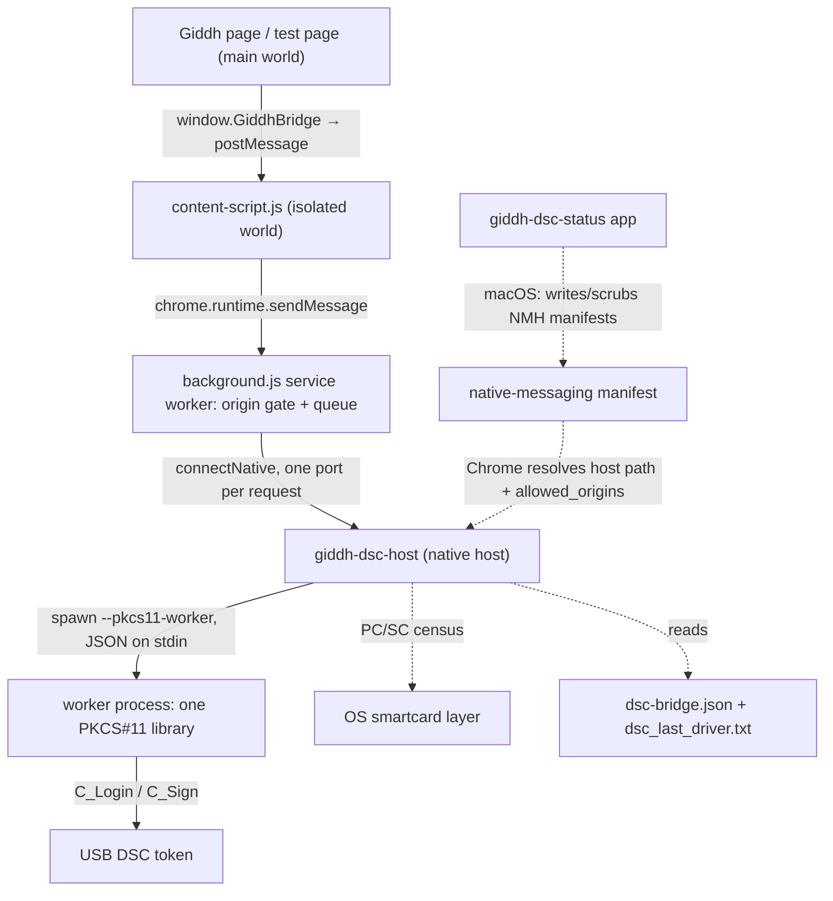

# Architecture & Mental Model

Three local components let a Giddh web page get a hash signed by a USB DSC token without the key or PIN leaving the machine: an MV3 Chrome extension (relay + origin gate), a Python native-messaging host frozen with PyInstaller (PKCS#11 broker that runs every driver call in a throwaway worker process), and a Tkinter status app (window plus macOS host registration). There is no server in this repo; the Giddh backend computes the hash and embeds the signature (see [`dsc-bridge/INTEGRATION.md`](../dsc-bridge/INTEGRATION.md)). Message shapes, error codes, the extension ID and the driver list are owned by [CONTRACTS.md](CONTRACTS.md).

## System Overview & Mental Model

## Entry Points & Bootstrap Sequence

| Component | Entry | Bootstrap |
|---|---|---|
| Extension | `dsc-bridge/extension/manifest.json` | Content script runs at `document_idle` on matched URLs, injects `bridge-inject.js` as a `<script src>` (CSP-safe), which defines `window.GiddhBridge` and fires `giddh-dsc-bridge-ready`. Service worker `background.js` registers one `chrome.runtime.onMessage` listener. |
| Native host | `dsc-bridge/native-host/giddh_dsc_host.py:main` | Chrome launches the binary named in the manifest. `__main__` branches: `--pkcs11-worker` → `dsc-bridge/native-host/pkcs11_signer.py:worker_main`; `--diagnose` → one JSON object on stdout (used by the macOS build smoke test); else the length-prefixed stdin loop. |
| Worker | `dsc-bridge/native-host/pkcs11_signer.py:worker_main` | Same binary re-executed (`_worker_argv`). Reads one JSON request, loads exactly one driver, replies one JSON line, exits. |
| Status app | `dsc-bridge/native-host/giddh_dsc_status.py:main` | On macOS calls `install_native_host` first, then draws `StatusApp` on a single `tk.Canvas`. |
| Dev launcher | `dsc-bridge/native-host/giddh_dsc_host.command` | Pins a python.org 3.13 interpreter path for unfrozen dev runs. |

## Process Model

- **One host process per request.** `dsc-bridge/extension/background.js:_nativeCall` opens `chrome.runtime.connectNative` for each call and disconnects after the first reply, so every request gets a fresh `C_Initialize` (token hot-swap keeps working; a wedged driver dies with its process). A port, not `sendNativeMessage`, keeps the MV3 worker alive during the call.
- **Single flight.** `dsc-bridge/extension/background.js:_enqueueNative` chains calls so at most one host runs; vendor drivers (ProxKey `libwdpkcs`) use a cross-process mutex that otherwise stalls for seconds.
- **One driver per worker process.** `dsc-bridge/native-host/pkcs11_signer.py:IsolatedSigner` never loads a PKCS#11 library itself; `_call_worker` runs `subprocess.run` per driver with a timeout. Loading two vendor libraries in one process corrupts the shared PC/SC view (observed `CKR_TOKEN_NOT_RECOGNIZED`). A driver segfault becomes `DRIVER_CRASHED`, not a dead bridge.
- **Timeouts nest:** extension 55 s (`NATIVE_OP_TIMEOUT_MS`) → host list budget 45 s / sign budget 180 s (`_LIST_BUDGET`, `_SIGN_BUDGET`) → worker 25 s probe / 120 s sign (`_PROBE_TIMEOUT`, `_SIGN_TIMEOUT`). The sign budgets exceed the extension's 55 s, so a slow sign is reported as `NATIVE_TIMEOUT` by the extension first (see notes in [OPEN_QUESTIONS.md](OPEN_QUESTIONS.md)).
- `dsc-bridge/native-host/giddh_dsc_host.py:_SignerCache` re-reads the config when its mtime changes. Its comment assumes a long-lived host; with one host per request it rebuilds every time (harmless).

## Major Modules & Responsibilities

| Module / Layer | Path | Core Responsibility | Sources of Truth | May Depend On | Must NOT Depend On |
|---|---|---|---|---|---|
| Page API | `dsc-bridge/extension/bridge-inject.js` | Defines `window.GiddhBridge` (`getCertificate`, `signHash`, `diagnose`, `listModules`, `version`); matches replies by local request id | Page caller | `window.postMessage` to same window | `chrome.*` APIs (main world has none) |
| Transport | `dsc-bridge/extension/content-script.js` | Accept only `event.source === window`; copy allowlisted keys (`hash`, `algorithm`, `certId`, `pin`, `driver`); relay to service worker | — | `chrome.runtime.sendMessage` | Any security decision (it runs on every matched page) |
| Gate + relay | `dsc-bridge/extension/background.js` | Origin allowlist, field allowlist, single-flight queue, per-request native port, timeouts | `sender.origin` / `sender.url` from Chrome | `chrome.runtime.connectNative` | Messages without the `GIDDH_DSC` type |
| Popup | `dsc-bridge/extension/popup.js` | Shows the manifest version only | `chrome.runtime.getManifest()` | — | `sendMessage` / `connectNative` (would bypass the tab-origin assumption) |
| Host protocol | `dsc-bridge/native-host/giddh_dsc_host.py` | Native-messaging framing (4-byte LE length, 10 MB cap), action dispatch, maps `Pkcs11Error` to `{success:false, code}` | Message `action` | `pkcs11_signer` | stdout for anything but framed replies (logs go to stderr) |
| PKCS#11 broker | `dsc-bridge/native-host/pkcs11_signer.py:IsolatedSigner` | Candidate ordering, worker spawn, cert aggregation across tokens, certId routing, budgets, busy retries, PC/SC diagnosis | Config + detected drivers | Worker processes, PC/SC | In-process driver loads |
| PKCS#11 driver ops | `dsc-bridge/native-host/pkcs11_signer.py:Pkcs11Signer` | Load one library, find a token, list certs, open session with PIN, `CKM_RSA_PKCS` sign | The token | `python-pkcs11`, `cryptography` | More than one library per process in production |
| Status app | `dsc-bridge/native-host/giddh_dsc_status.py` | Static info window; macOS host registration and stale-manifest scrub | `_buildinfo.py` (`GIDDH_EXT_ID`, generated at build) | `pkcs11_signer` is NOT imported | Signing or token access <!-- verify:ignore --> |
| Self test | `dsc-bridge/native-host/selftest.py` | 5 stages: detect, load, list, sign, verify. **Broken at `c591bc2`** (exits 2 at import; see [OPEN_QUESTIONS.md](OPEN_QUESTIONS.md) Q-012) | — | `pkcs11_signer` | — |

## Module Map of `pkcs11_signer.py`

| Concern | Symbols |
|---|---|
| Driver discovery per OS | `dsc-bridge/native-host/pkcs11_signer.py:_DRIVER_CANDIDATES` (static paths for `darwin`, `linux`, `win32`), `_glob_driver_candidates` (vendor-name globs per OS; macOS also scans `/Applications/*.app/Contents/MacOS`), `_win32_registry_candidates` (Feitian, Watchdata, SafeNet, Gemalto keys), merged by `list_driver_candidates` |
| Ranking | `rank_driver_candidates` + `_driver_rank`: vendor names (`_VENDOR_DRIVER_HINTS`) rank 0, unknown 3, OpenSC 5, `pkcs11-spy` dropped; on macOS arch-matched (`macho_arches` vs `python_arch`) before mismatched |
| User config | `config_path`, `load_module_config`, `resolve_driver_paths` (`modules`, `preferred_module`, `strict_module`, legacy `pkcs11_driver` = pin + strict). Writers `attach_module`, `detach_module`, `set_preferred_module`, `set_strict_module` have no callers since the status-app module manager was removed (fe15172); the file is now hand-edited only |
| Order of attempts | `IsolatedSigner._ordered_candidates`: strict → pinned only; else last-known-good (`_load_last_driver`) and pinned moved first |
| Driver loading quirks | `Pkcs11Signer._load_lib`: `_stage_bundled_driver` copies an in-`.app` dylib to `~/Library/Application Support/Giddh/drivers` (macOS library validation); `cleanup_stale_driver_locks` removes orphaned `lockfinddevice*` dirs; arch mismatch → `ARCH_MISMATCH` <!-- verify:ignore --> |
| Sessions | Opened per operation and closed in `finally`. `list_certificates` reads without login, then retries `session.login("")`, else `PIN_REQUIRED`. `sign_hash` opens with `user_pin=pin` (C_Login) |
| Signing | `_wrap_digest_info` prepends the DER DigestInfo for SHA-256/384/512 and checks length (`BAD_HASH`, `BAD_ALGO`); private key found by `CKA_ID` = cert id; mechanism `RSA_PKCS`. RSA only |
| PDF vs raw hash | The host only ever signs a precomputed digest. For a PDF the Giddh server's `/dsc/prepare` <!-- verify:ignore --> returns the hash of the PAdES signed attributes; the test page's "raw hash" checkbox sends a pasted base64 digest instead of SHA-256 of typed text. No PDF code exists in this repo |
| Multi-token routing | `_encode_cert_id` prefixes the raw `CKA_ID` with base64url(driver path); `_decode_cert_id` routes `sign_hash` to that driver |
| Failure diagnosis | `pcsc_reader_states` (PCSC.framework / `winscard.dll` / `libpcsclite.so.1`) and `_classify_card_failure` → `TOKEN_BUSY_OR_ABSENT`, `TOKEN_UNSUPPORTED_BY_MODULE`, `NO_TOKEN` |
| Inventory | `IsolatedSigner._module_rows` shared by `list_modules` and `diagnose`, each module probed in its own worker |

## Trust Boundaries

| Boundary | Check | Where |
|---|---|---|
| Web → extension | Content script only injected on `https://*.giddh.com/*`, `http(s)://localhost`, `http(s)://127.0.0.1`, `file:///*` | `dsc-bridge/extension/manifest.json` `content_scripts.matches` |
| Frame → content script | `event.source === window` (no iframe can post) | `dsc-bridge/extension/content-script.js` |
| Content script → service worker | Origin allowlist on Chrome-set `sender.origin`: HTTPS `giddh.com` and `*.giddh.com`, localhost/127.0.0.1 on any scheme, any file URL. Else `ORIGIN_NOT_ALLOWED`. `ALLOW_ALL_ORIGINS` must stay `false` | `dsc-bridge/extension/background.js:_isAllowedOrigin` |
| Field smuggling | Key-by-key copy in both content script and service worker | `background.js` onMessage listener |
| Extension → host | Chrome only launches the host if the manifest's `allowed_origins` contains `chrome-extension://<id>/`; the ID is fixed by the manifest `key`. Mismatch → "Access to the specified native messaging host is forbidden" | installer-written `com.giddh.dsc.bridge.json` <!-- verify:ignore --> |
| Page → driver load | `listModules` is read-only; `getCertificate(driver)` is accepted only if the path is in the host's detected list | `IsolatedSigner.list_certificates` |
| PIN | Supplied by the page, carried in memory through every hop, reaches the worker over stdin (never argv), used for C_Login, never stored or logged. The token enforces retries and lockout | `IsolatedSigner.sign_hash`, `Pkcs11Signer.sign_hash` |
| What gets signed | Any 32/48/64-byte digest an allowed page sends. The bridge cannot see the document; the user's PIN entry is the only consent | `_wrap_digest_info` |

> [!WARNING]
> At `c591bc2` the driver tag used by `sign_hash` was not checked against the detected drivers, unlike `list_certificates`. The fix is in [PR #2](https://github.com/Walkover-Web-Solution/giddh-dsc-bridge/pull/2); see [OPEN_QUESTIONS.md](OPEN_QUESTIONS.md).

## Application State Ownership

| State Kind | Owner / Tool | Lifespan | Invalidation / Reset Rule |
|---|---|---|---|
| Pending page requests | `_pending` map in `bridge-inject.js` | Page lifetime | Deleted when the matching reply arrives; none on timeout (the extension always replies) |
| Native call queue | `_nativeChain` in `background.js` | Service worker lifetime | Every call resolves (never rejects), so the chain never stalls |
| Module config | `dsc-bridge.json` at `dsc-bridge/native-host/pkcs11_signer.py:config_path` | Persistent, per user | Re-read on mtime change; hand-edited today <!-- verify:ignore --> |
| Last good driver | `dsc_last_driver.txt` in `_state_dir` | Persistent, per user | Overwritten whenever a driver serves a token or a PIN error <!-- verify:ignore --> |
| Staged macOS drivers | `~/Library/Application Support/Giddh/drivers` <!-- verify:ignore --> | Persistent | Re-copied when source mtime/size changes |

## Install Locations

<!-- verify:ignore-start -->
| OS | Host binary | Status app | Native-messaging manifest | Written by |
|---|---|---|---|---|
| macOS (.pkg inside .dmg) | `/usr/local/giddh-dsc-bridge/giddh-dsc-host` (+ `_internal/`) | `/Applications/Giddh DSC Bridge.app` (also bundles a host copy) | `/Library/Google/Chrome[ Beta]/NativeMessagingHosts`, `/Library/Microsoft/Edge/…`, `/Library/Application Support/Chromium/…`, `/Library/Application Support/BraveSoftware/Brave-Browser/…` | `packaging/macos/scripts/postinstall` (root) |
| macOS fallback | host inside the `.app` | same | `~/Library/Application Support/{Google/Chrome,BraveSoftware/Brave-Browser,Microsoft Edge,Chromium}/NativeMessagingHosts` | status app `install_native_host`, only if the system host is missing |
| Windows (.exe, per user, no admin) | `%LOCALAPPDATA%\Giddh DSC Bridge\giddh-dsc-host.exe` | `…\status\giddh-dsc-status.exe` | `{app}\com.giddh.dsc.bridge.json`, pointed to by `HKCU\SOFTWARE\{Google\Chrome,Microsoft\Edge,BraveSoftware\Brave-Browser,Chromium}\NativeMessagingHosts\com.giddh.dsc.bridge` | `packaging/windows/installer.iss` |
| Linux (.deb) | `/opt/giddh-dsc-bridge/giddh-dsc-host` | `/opt/giddh-dsc-bridge/status/` + `.desktop` | `/etc/opt/chrome`, `/etc/chromium`, `/etc/opt/edge`, `/etc/opt/brave` `/native-messaging-hosts/` | `packaging/linux/debian/postinst`; removed by `prerm` |
| Per-user state | — | — | macOS `~/Library/Application Support/Giddh/`, Windows `%APPDATA%\Giddh\`, Linux `~/.config/giddh/` | host at runtime |
<!-- verify:ignore-end -->

**The user-level host issue (c591bc2).** Chrome prefers a user-level `NativeMessagingHosts` manifest over the system one. Older status apps copied the signed host into `~/Library/Application Support/Giddh DSC Bridge/`, which broke the Python framework signature, so Chrome launched a broken host ("Native host has exited"). Now `packaging/macos/scripts/preinstall` wipes the previous install, `postinstall` deletes that folder and every user-level manifest for all users, and `dsc-bridge/native-host/giddh_dsc_status.py:_remove_stale_user_native_host` does the same on each launch. The status app writes user-level manifests only when `/usr/local/giddh-dsc-bridge/giddh-dsc-host` is absent, and then points them at the host inside the `.app` (never a copy). <!-- verify:ignore -->

## Business Rules & Logic Placement

- **Origin policy:** `dsc-bridge/extension/background.js:_isAllowedOrigin` only. Keep `manifest.json` `matches`/`web_accessible_resources` in step.
- **Driver choice:** `dsc-bridge/native-host/pkcs11_signer.py:resolve_driver_paths` + `rank_driver_candidates` + `IsolatedSigner._ordered_candidates`.
- **Which errors stop the search:** `IsolatedSigner._run_on_token` — "not this driver" codes continue; PIN/key/hash codes stop and are reported; others are kept as the best explanation.
- **User-facing error text:** written in `pkcs11_signer.py` (`_BUSY_HINT`, `_UNSUPPORTED_HINT`) and `background.js`; Giddh shows it as-is.

## Layer Rules

- Never load a PKCS#11 library in the host or broker process; only in `worker_main`.
- Never write to stdout in the host except framed replies; vendor drivers that print are tolerated in workers (the last stdout line is parsed).
- Never accept a driver path from the page unless it is in the detected list. Never expose attach/pin to the page.
- Never pass the PIN in argv, logs or files.
- Do not give the popup or any extension page a path to `connectNative`; review `_isAllowedOrigin` deliberately first.
- Keep `bridge-inject.js` `version` and `manifest.json` `version` in step (see [DEVELOPMENT.md](DEVELOPMENT.md)).

## Where to Add Things

| Change | Touch |
|---|---|
| New token vendor | Add paths to `_DRIVER_CANDIDATES` for each OS, a name stem to `_glob_driver_candidates` patterns, a hint to `_VENDOR_DRIVER_HINTS`, a registry key to `_win32_registry_candidates` if the vendor records one; update the driver list in [CONTRACTS.md](CONTRACTS.md); run `--diagnose` (the driver is detected and ranked), then read certs and sign on `dsc-bridge/test-page/index.html` with the token. `selftest.py` is broken (Q-012) |
| New message type | `bridge-inject.js` (API method) → `content-script.js` and `background.js` (add any new field to both key allowlists) → `dsc-bridge/native-host/giddh_dsc_host.py:main` dispatch + `_handle_*` → `IsolatedSigner` method and, if it touches a driver, a `worker_main` op. Document in [CONTRACTS.md](CONTRACTS.md); bump the page-script `version` |
| New allowed origin | `manifest.json` (both match lists) and `_isAllowedOrigin` |
| New browser | Manifest dir in `postinstall`, `postinst`/`prerm`, `installer.iss` `[Registry]`, and `_mac_browser_profile_roots` |

## External Systems & Dependencies

| External System | Purpose | Communication Contract | Location in Code |
|---|---|---|---|
| Giddh web app | Calls `window.GiddhBridge`, prompts for the PIN, runs its `signFlow` orchestrator (in the Giddh repo, not here) <!-- verify:ignore --> | [CONTRACTS.md](CONTRACTS.md), [`dsc-bridge/INTEGRATION.md`](../dsc-bridge/INTEGRATION.md) | `dsc-bridge/extension/bridge-inject.js` |
| Giddh backend | `/dsc/prepare` (hash) and `/dsc/finish` (embed CMS); never sees PIN or key | [`dsc-bridge/INTEGRATION.md`](../dsc-bridge/INTEGRATION.md) | none in this repo <!-- verify:ignore --> |
| Chrome native messaging | Launches host, enforces `allowed_origins` | Manifest `com.giddh.dsc.bridge` | `dsc-bridge/extension/background.js:NATIVE_HOST_NAME` |
| Vendor PKCS#11 drivers | Talk to the token | PKCS#11 via `python-pkcs11` | `dsc-bridge/native-host/pkcs11_signer.py:Pkcs11Signer` |
| PC/SC | Ground truth on card presence/lock | `SCardConnect` exclusive probe | `dsc-bridge/native-host/pkcs11_signer.py:pcsc_reader_states` |
