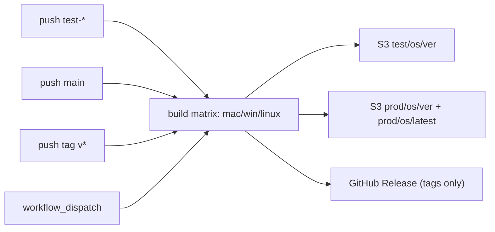

# Development & Verification Guide

There is no web server, no package manager and no test suite. Development means running the
Python host from source behind the unpacked extension, poking it from `dsc-bridge/test-page/index.html`,
and building installers per OS (locally, or in CI). Verified on macOS (arm64) on 2026-11-17 in a
scratch copy; nothing was installed or registered.

## Prerequisites & Runtime Environment

- **Python:** 3.11 in CI (`.github/workflows/build-packages.yml`, `actions/setup-python`). Locally,
  3.9.6 (macOS system Python) installs the deps, compiles every `.py` and runs `--diagnose`.
  `packaging/windows/build_windows.ps1` says 3.9+. Do not use 3.14 for builds: PyInstaller did not
  support it (commit `7c94b03`).
- **Python deps:** `dsc-bridge/native-host/requirements.txt` (`python-pkcs11`, `cryptography`;
  resolved to 0.9.4 and 50.0.2 on 2026-11-17). Builds also need `pyinstaller` and `pillow`
  (installed by CI, not pinned anywhere).
- **Node:** only for `node --check` on the extension JS. There is no `package.json`.
- **Chrome** (or Edge/Brave/Chromium) with Developer mode.
- **A DSC token plus its vendor's PKCS#11 driver** for anything past driver detection.
- **Per-OS packaging tools:** macOS `pkgbuild`/`productsign`/`hdiutil` (ship with macOS);
  Windows Inno Setup 6 (`ISCC.exe`); Linux `dpkg-deb` and `python3-tk`. PyInstaller cannot
  cross-compile, so each installer is built on its own OS.

## Step-by-Step Setup

1. **Python environment (outside the repo or in the gitignored `.venv/`):** <!-- verify:ignore -->
   ```bash
   python3 -m venv .venv
   .venv/bin/pip install -r dsc-bridge/native-host/requirements.txt
   ```
2. **Load the extension unpacked:** `chrome://extensions` → Developer mode → **Load unpacked** →
   `dsc-bridge/extension/`. The manifest `key` is the Chrome Web Store public key, so the unpacked
   copy gets the store ID `pbnmboohmdoknhpflpmeocccojkkjgng` (checked: the SHA-256 of the key
   maps to that ID). For the `file://` test page also turn on **Details → Allow access to file URLs**. <!-- verify:ignore -->
3. **Point Chrome at the host source (dev only; nothing in the repo does this for you).**
   Chrome launches whatever the `com.giddh.dsc.bridge` manifest's `path` names. Write a user-level
   manifest at `~/Library/Application Support/Google/Chrome/NativeMessagingHosts/com.giddh.dsc.bridge.json`
   (macOS; on Linux `~/.config/google-chrome/NativeMessagingHosts/`, on Windows an `HKCU` key as in
   `packaging/windows/installer.iss`):
   ```json
   {
     "name": "com.giddh.dsc.bridge",
     "description": "Giddh DSC Bridge (dev)",
     "path": "/ABSOLUTE/PATH/TO/a-launcher-script",
     "type": "stdio",
     "allowed_origins": ["chrome-extension://pbnmboohmdoknhpflpmeocccojkkjgng/"]
   }
   ```
   The launcher must `exec` a Python that has the deps, on `dsc-bridge/native-host/giddh_dsc_host.py`,
   and print nothing to stdout. `dsc-bridge/native-host/giddh_dsc_host.command` is such a launcher but
   pins `/Library/Frameworks/Python.framework/Versions/3.13/bin/python3`; keep a private copy that
   points at your venv rather than editing the committed one.
4. **Open the test page:** `dsc-bridge/test-page/index.html` (as `file://`, or served from <!-- verify:ignore -->
   `localhost`). It checks the bridge, runs diagnose, lists modules, reads certificates (with a token
   picker) and signs a hash. See [DESIGN.md](DESIGN.md) for its screens.

Footguns in this loop:
- **Installing the macOS `.pkg` deletes your dev manifest.** `packaging/macos/scripts/postinstall`
  removes every user-level `com.giddh.dsc.bridge.json` for all users, so the system host in
  `/usr/local/giddh-dsc-bridge` wins. Re-create the dev manifest after installing a build.
- **Running the status app from source on macOS also deletes it.**
  `dsc-bridge/native-host/giddh_dsc_status.py:main` calls `install_native_host`, which calls
  `_remove_stale_user_native_host` and removes the user-level manifests and
  `~/Library/Application Support/Giddh DSC Bridge`. Without a built `_buildinfo.py` it then shows a
  "Setup notice" warning, which is expected.
- After editing the extension, click reload on `chrome://extensions`. After editing the host, no
  reload is needed: `background.js` opens a fresh `connectNative` port per call.
- Never ship `ALLOW_ALL_ORIGINS = true` (`dsc-bridge/extension/background.js`). `localhost`,
  `127.0.0.1` and `file://` are already allowed. See [CONTRACTS.md](CONTRACTS.md) for the allowlist. <!-- verify:ignore -->

## Environment Variables Reference

The bridge reads no environment variables at runtime. The build scripts and CI do.

| Variable Name | Required | Client-Exposed | Default Value | Description / Where Read |
|---|---|---|---|---|
| `VERSION` | No | No | contents of `VERSION` | Package version. Read by `packaging/macos/build_macos.sh`, `packaging/linux/build_deb.sh`, `packaging/windows/freeze.ps1`, `packaging/windows/build_installer.ps1`; CI sets it (see Versioning) |
| `GIDDH_EXT_ID` | No | No | contents of `packaging/extension-id.txt` | Extension ID written into the host manifest's `allowed_origins`. CI passes the repo **variable** `vars.GIDDH_EXT_ID`; if that variable is set it overrides the file |
| `APPLE_SIGNING_IDENTITY` | No | No | auto-detected from keychain | Developer ID Application identity (`build_macos.sh`) |
| `APPLE_INSTALLER_IDENTITY` | No | No | auto-detected | Developer ID Installer identity; without it the `.pkg` ships unsigned and un-notarized |
| `APPLE_ID`, `APPLE_APP_SPECIFIC_PASSWORD`, `APPLE_TEAM_ID` | No | No (secret) | — | `notarytool` credentials; notarization is skipped when any is missing |
| `HOST_EXE_PATH`, `STATUS_EXE_PATH`, `INSTALLER_PATH`, `PACKAGE_VERSION` | — | No | — | Outputs written to `$GITHUB_ENV` by `freeze.ps1` / `build_installer.ps1` for the signing steps |

## Build & Preview Verification

One OS per machine:

| OS | Command | Output |
|---|---|---|
| macOS | `./packaging/macos/build_macos.sh` | `dist/GiddhDSCBridge-<ver>.pkg` and `dist/GiddhDSCBridge-<ver>.dmg` (the DMG holds `GiddhDSCBridge.pkg`) |
| Windows | `./packaging/windows/build_windows.ps1` (unsigned: `freeze.ps1` + `build_installer.ps1`) | `dist/GiddhDSCBridge-Setup-<ver>.exe` |
| Linux | `./packaging/linux/build_deb.sh` | `dist/giddh-dsc-bridge_<ver>_<arch>.deb` |

- `build_macos.sh` runs the staged host with `--diagnose` as a smoke test and fails the build if it
  does not start. It signs only when identities exist in the active keychain. **Do not run it on a
  machine whose login keychain holds the company's Developer ID** unless you mean to sign.
- Every script writes `dsc-bridge/native-host/_buildinfo.py` during the build and deletes it on exit <!-- verify:ignore -->
  (gitignored). On macOS it carries `VERSION` and `GIDDH_EXT_ID`; on Windows and Linux only `VERSION`.
- Installing a build changes system state (macOS needs admin and writes under `/Library`). For where
  each installer puts files, see [ARCHITECTURE.md](ARCHITECTURE.md).

## Running Automated Checks & Tests

There is no automated test suite and no linter config. These checks are what exists:

| Check Suite | Command | What It Validates |
|---|---|---|
| Python compile | `python3 -m py_compile dsc-bridge/native-host/*.py` | Syntax of host, signer, status app, selftest (passes) |
| Extension JS syntax | `node --check dsc-bridge/extension/<file>.js` (each of the 4) | Syntax only (passes) |
| Manifest JSON | `python3 -c "import json;json.load(open('dsc-bridge/extension/manifest.json'))"` | Valid JSON (passes) |
| Host diagnose (no PIN) | `python3 dsc-bridge/native-host/giddh_dsc_host.py --diagnose` | Prints one JSON object: candidate drivers, ranking, slots, tokens, PC/SC readers. Exit 0 if diagnose succeeded |
| Host framing | `python3 dsc-bridge/native-host/test_host.py` | Sends one framed `getCertificate` to the host and prints the reply. Touches the token |
| Self-test | `python3 dsc-bridge/native-host/selftest.py [--no-sign] [--driver PATH]` | **Broken: exits 2 at import** (see below) |
| CI build | push to `test-*` | All three installers build; macOS smoke test passes |

`dsc-bridge/native-host/selftest.py` is meant to run five stages (driver detection, load, list certs,
sign with PIN, verify signature with `cryptography`). It needs a plugged-in token for stages 3 to 5
and prompts for the PIN at stage 4 (`--no-sign` stops after stage 3). **At `c591bc2` it cannot start:**
it imports `_select_driver` from `giddh_dsc_host`, which does not exist in any commit (ranking moved
to `dsc-bridge/native-host/pkcs11_signer.py:rank_driver_candidates`). It exits 2 with
`FATAL: cannot import bridge modules`, with or without a token. Use `--diagnose` and the test page
until it is fixed. `dsc-bridge/INTEGRATION.md`'s pre-handoff checklist still asks for it.

## Safe Test-Data Guidance

- **Tokens:** use a test DSC token or your own. Never a customer's token or PIN. Nothing in the repo
  provides a software token.
- **PINs:** type them into the test page or the selftest prompt. Avoid `selftest.py --pin` in
  shared shells (it lands in shell history). Do not log or paste PINs anywhere. Vendor tokens
  usually lock after a few wrong PINs (general knowledge; the count depends on the vendor), so stop
  after one failure.
- **What gets signed:** the test page signs the SHA-256 of a text you type, or a raw base64 hash if
  "Input is already a SHA-256 hash" is ticked. Sign only throwaway strings. A signature over a real
  document hash is a real legal signature.
- **Drivers:** `--diagnose` loads every candidate PKCS#11 driver in an isolated worker. That is
  read-only, but a buggy vendor driver can still hang the token until it is re-inserted.

## How an Agent Checks Its Work (Verification Checklist)

1. **Baseline:** run the compile, `node --check` and manifest checks above (all pass at `c591bc2`).
2. **Host/signer change:** compile, then `--diagnose`. If a token is available, the test page reads
   certs and signs. Without a token, say so: signing is unverified.
3. **Extension change:** `node --check`, reload unpacked, confirm the ID still reads
   `pbnmboohmdoknhpflpmeocccojkkjgng`, test page shows "bridge detected". If origins changed, the
   `matches` in `dsc-bridge/extension/manifest.json` and the lists in `background.js` must agree.
4. **Packaging/CI change:** read it and push to a `test-*` branch to see the matrix; never run
   signing, notarization or installers on a developer machine to "check".
5. **Version bump:** the version strings agree (see Versioning).
6. **Docs:** update the owning `docs/*.md` in the same change, then run the create-ai-docs
   `verify_docs.py` against the repo (0 errors).

## PR Workflow & Deployment Pipeline

Confirmed by the owner, 2026-11-17: **PR to `main` → CI builds test installers; a `v*` tag publishes
the release installers; the extension is uploaded to the Chrome Web Store by hand.**

What `.github/workflows/build-packages.yml` actually does differs (see the warning below):



### Flow Steps
1. **Branch** from `main`; for an installer you can try, push a `test-*` branch. It builds
   everything and uploads to `s3://$S3_BUCKET/test/<os>/<ver>/`.
2. **PR to `main`.** The workflow has **no `pull_request` trigger**, so a PR alone builds nothing. <!-- verify:ignore -->
3. **Merge to `main`.** Builds, uploads to `prod/<os>/<ver>/` **and overwrites `prod/<os>/latest/`**:
   `upload_to_s3` treats every ref that is not `test-*` as `prod`.
4. **Tag `vX.Y.Z`** and push it. Version comes from the tag; artifacts go to S3 prod and latest, and the
   `release` job attaches all files to a GitHub Release.
5. **Chrome Web Store (manual).** Zip `dsc-bridge/extension/` **without the `key` field** (the store
   rejects it, per `README.md`) and upload it in the developer dashboard. No script exists.
   > [!TODO] Owner: who holds the Chrome Web Store account, and is the store version bumped with every tag or only when the extension changes?

> [!WARNING]
> The code publishes to `prod/.../latest` on every push to `main`, but the owner's flow says only a
> `v*` tag publishes release installers. One of them is wrong. Until the owner settles it, assume a
> merge to `main` changes what end users download. Raised in [OPEN_QUESTIONS.md](OPEN_QUESTIONS.md).

### CI jobs, signing and secrets (names only)

| Job / step | Runs on | Needs |
|---|---|---|
| `build` (matrix `macos-latest`, `windows-latest`, `ubuntu-latest`, `fail-fast: false`) | every trigger | Python 3.11, `pip install pyinstaller pillow` + requirements |
| macOS: import certs → `build_macos.sh` (deep-sign `_internal` → sign host and `.app` with `packaging/macos/entitlements.plist` → `pkgbuild` → `productsign` → notarize and staple `.pkg` → DMG) → sign, notarize, staple DMG, `spctl` check | macOS | secrets `APPLE_CERTIFICATE_BASE64`, `APPLE_CERTIFICATE_PASSWORD`, optional `APPLE_INSTALLER_CERTIFICATE_BASE64`, `APPLE_INSTALLER_CERTIFICATE_PASSWORD`, `APPLE_ID`, `APPLE_APP_SPECIFIC_PASSWORD`, `APPLE_TEAM_ID`; var `GIDDH_EXT_ID` |
| Windows: Inno Setup → `freeze.ps1` → eSigner sign host and status `.exe` → `build_installer.ps1` → eSigner sign installer | Windows | secrets `ES_USERNAME`, `ES_PASSWORD`, `ES_CREDENTIAL_ID`, `ES_TOTP_SECRET` (all four, or signing is skipped silently); var `GIDDH_EXT_ID`. Details: [WINDOWS_SIGNING.md](WINDOWS_SIGNING.md) |
| Linux: `python3-tk` → `build_deb.sh` | Ubuntu | var `GIDDH_EXT_ID` |
| `upload_to_s3` | after `build` | secrets `AWS_ACCESS_KEY_ID`, `AWS_SECRET_ACCESS_KEY`, `AWS_REGION`, `S3_BUCKET` |
| `release` | tags `refs/tags/v*` only | `GITHUB_TOKEN` via `permissions: contents: write` | <!-- verify:ignore -->

Degradation, observed in the scripts: with no Developer ID Application identity the import step
**fails** the macOS job. With no Installer identity the `.pkg` and DMG ship unsigned and
un-notarized (a warning, not an error). With no notary credentials notarization is skipped. A failed
notarization fails the job. `docs/WINDOWS_SIGNING.md` says signing is inactive and that each step is
followed by `Get-AuthenticodeSignature`. That verification was removed in `f492206`, and commit `41ca3a5`
says the secrets were "already configured". Whether Windows builds are signed today is unverified.

## Versioning

| Where | Value at `c591bc2` | Who reads it |
|---|---|---|
| `VERSION` | `1.0.0` | Build-script default; PyInstaller specs (**they prefer the file over env `VERSION`**); status app at runtime |
| Git tag `vX.Y.Z` | no tags exist | CI sets `VERSION=X.Y.Z` → installer file names, `pkgbuild --version`, Inno `AppVersion`, `_buildinfo.py` |
| `dsc-bridge/extension/manifest.json` `version` | `1.0.0` | Chrome / Web Store; shown in the popup |
| `dsc-bridge/extension/bridge-inject.js` `version` | `1.0.0` | `window.GiddhBridge.version`, shown by the test page |
| `dsc-bridge/native-host/giddh_dsc_host.py:_handle_ping` | **`1.1.0` (hard-coded)** | `ping` reply |
| `packaging/windows/version_info.txt` | **`1.1.0` (hard-coded)** | Windows file properties of both `.exe` |
| Fallbacks when `VERSION` is missing | `1.0.0` (`build_macos.sh`, status app), `1.1.0` (specs, `build_deb.sh`, `.ps1`) | — |

The three manual strings agree (`1.0.0`); the ping reply and Windows file version do not. To release:
edit `VERSION`, `manifest.json` and `bridge-inject.js` (and, until they read `VERSION`, `_handle_ping`
and `version_info.txt`), merge, then tag `vX.Y.Z` with the same number. Tagging without editing
`VERSION` gives installers named for the tag but an `.app` bundle version from the file.
Release history: 1.7.0 (`d023856`), reset to 1.0.0 for the store launch (`1e3796b`, `d59ef5e`); see
[DECISIONS.md](DECISIONS.md).

## Repository hygiene

`.gitignore` keeps out `giddh-extension-key.pem` (the legacy local key for the old dev ID; not the
store key), `dsc-bridge/native-host/_buildinfo.py`, `build/`, `dist/`, `packaging/macos/build/`, <!-- verify:ignore -->
`packaging/linux/build/`, venvs and caches. Its lower half is an auto-generated Node template that <!-- verify:ignore -->
duplicates entries. Never commit `.p12`, `.pem` or credentials; CI decodes the Apple certs into a
temporary keychain only.
