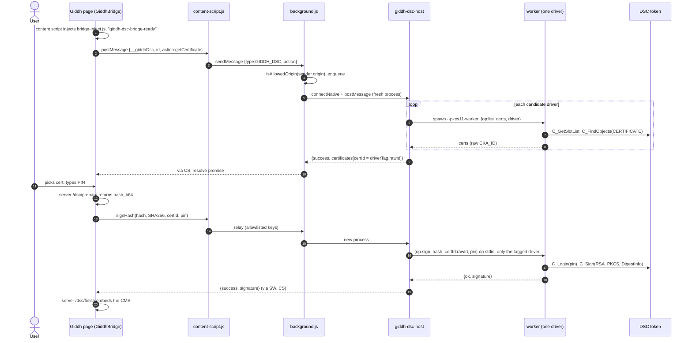

# User Flows & Critical Journeys

The user is a staff member at a Giddh customer business signing an invoice or document with their own DSC token from the Giddh web app (confirmed by the owner, 2026-11-17). Every journey runs on their machine: page → extension → native host → worker → token. Field names, codes and the driver list live in [CONTRACTS.md](CONTRACTS.md); components and install paths in [ARCHITECTURE.md](ARCHITECTURE.md). The Giddh page code (`dsc-signing.js`, `signFlow`) is in the Giddh repo, not here; `dsc-bridge/test-page/index.html` exercises the same API. <!-- verify:ignore -->

## Core User Journeys Map

| Flow Name | Trigger / Starting Route | Target Outcome | Primary Route & Component |
|---|---|---|---|
| Install | User runs the `.dmg`/`.pkg`, `.exe` or `.deb`; adds the store extension | Host registered for Chromium browsers | `packaging/macos/scripts/postinstall`, `packaging/windows/installer.iss`, `packaging/linux/debian/postinst` |
| Detect bridge | Giddh page loads on an allowed origin | `window.GiddhBridge` present, `giddh-dsc-bridge-ready` fired | `dsc-bridge/extension/content-script.js`, `dsc-bridge/extension/bridge-inject.js` |
| List tokens / certificates | Page calls `listModules()` / `getCertificate(driver?)` | Signing certs (with chain) from every plugged-in token | `dsc-bridge/native-host/pkcs11_signer.py:IsolatedSigner` |
| Sign | Page calls `signHash(hash, "SHA256", certId, pin)` | Base64 PKCS#1 v1.5 signature | `dsc-bridge/native-host/giddh_dsc_host.py:_handle_sign_hash` |
| Diagnose | Page `diagnose()`, or `selftest.py`, or `giddh-dsc-host --diagnose` | Per-driver report | `dsc-bridge/native-host/pkcs11_signer.py:IsolatedSigner` |
| Status app | User opens "Giddh DSC Bridge" | Info window; macOS host registration repaired | `dsc-bridge/native-host/giddh_dsc_status.py:main` |
| Uninstall | OS uninstaller / `apt remove` / manual on macOS | Host and manifests removed | `packaging/linux/debian/prerm`, `packaging/windows/installer.iss` |

---

## Flow: Install

1. **Windows** — `packaging/windows/installer.iss`: per-user, no admin, into `%LOCALAPPDATA%\Giddh DSC Bridge`. `CurStepChanged` writes `com.giddh.dsc.bridge.json` with `allowed_origins` from `ExtId`; `[Registry]` points HKCU keys for Chrome, Edge, Brave, Chromium at it. Start-menu shortcut to the status app. <!-- verify:ignore -->
2. **macOS** — the `.dmg` holds `GiddhDSCBridge.pkg` and a readme. `packaging/macos/scripts/preinstall` (root) deletes the previous `/usr/local/giddh-dsc-bridge` and `.app`; the payload installs both; `packaging/macos/scripts/postinstall` copies the manifest to the system `NativeMessagingHosts` dirs, deletes every user's stale user-level manifests and `~/Library/Application Support/Giddh DSC Bridge`, and strips quarantine. <!-- verify:ignore -->
3. **Linux** — `packaging/linux/debian/postinst` copies the manifest from `/opt/giddh-dsc-bridge` to the four `/etc/.../native-messaging-hosts` dirs. <!-- verify:ignore -->
4. **Extension** — installed from the Chrome Web Store (uploaded by hand; confirmed by the owner, 2026-11-17). Its ID must equal the one baked into the manifest (`packaging/extension-id.txt`).
5. **Driver** — the user installs their token vendor's PKCS#11 driver separately; the bridge ships none.

Side effects: system manifest files, HKCU keys (Windows), removal of user-level manifests (macOS). Nothing is contacted over the network.

---

## Detailed Journey: Detect Bridge, Read Certificates, Sign

### 1. Happy Path Sequence

### 2. Step-by-Step Path & Code Connections

1. **Detection** — `dsc-bridge/extension/content-script.js` runs at `document_idle` only on manifest-matched URLs and appends `<script src=bridge-inject.js>`. `dsc-bridge/extension/bridge-inject.js` sets `window.GiddhBridge` and dispatches `giddh-dsc-bridge-ready`. A page detects the bridge by that event or by polling `window.GiddhBridge` (the test page re-checks after 800 ms). `GiddhBridge.version` reveals a stale cached page script after an extension update.
2. **Relay** — the content script copies only `hash`, `algorithm`, `certId`, `pin`, `driver` and calls `chrome.runtime.sendMessage`. `dsc-bridge/extension/background.js` checks the origin, copies the same keys again, and queues via `_enqueueNative`; one host process per request (`_nativeCall`).
3. **Read certificates** — `dsc-bridge/native-host/giddh_dsc_host.py:_handle_get_certificate` → `IsolatedSigner.list_certificates`. With `driver` (a path the host itself reported via `listModules`) only that driver is read; otherwise pinned → last-known-good → ranked drivers, each in its own worker, and certificates from **all** tokens are aggregated. CA certs are returned as `chain` on each signing cert, not as choices. No certs anywhere → re-run through `_run_on_token` purely to produce the PC/SC-aware error.
4. **PIN entry** — the bridge has no PIN UI. Giddh's page prompts (`onPinRequired` in `signFlow`); the test page uses the `#pin` password field. The PIN goes page → `window.postMessage` → content script → service worker → native port → host → worker stdin → `token.open(user_pin=pin)` (C_Login). It is never written to disk, argv or logs, and never reaches the Giddh server. <!-- verify:ignore -->
5. **Sign** — `IsolatedSigner.sign_hash` decodes the driver tag from `certId` (`_decode_cert_id`) and signs on that driver only. The worker's `Pkcs11Signer.sign_hash` base64-decodes the hash, wraps it in DigestInfo (`_wrap_digest_info`), finds the private key whose `CKA_ID` matches, signs with `RSA_PKCS`. Session closed in `finally`.
6. **Result** — `{success:true, signature}` back to the page. The worker that succeeded is saved as last-known-good (`_save_last_driver`).

### 3. Alternative Paths & Conditional Branches

- **PDF signing (production):** the hash is the PAdES signed-attributes digest from Giddh's `/dsc/prepare`; the signature goes to `/dsc/finish`. Send the `chain` from `getCertificate` at prepare time. See [`dsc-bridge/INTEGRATION.md`](../dsc-bridge/INTEGRATION.md). <!-- verify:ignore -->
- **Raw hash (test page):** with "raw hash" ticked, the input is sent as an already-base64 SHA-256 digest; otherwise the page hashes the typed text with `crypto.subtle.digest`. Both call the same `signHash`.
- **Several tokens plugged in:** all signing certs are listed; each `certId` carries its driver so signing touches only that token. The test page's token picker (`listModules` + unrestricted `getCertificate` to label options by owner) lets the user narrow reads to one driver.
- **Pinned module:** `strict_module` in `dsc-bridge.json` makes the host try only that module; errors then say so. <!-- verify:ignore -->
- **Token needs PIN to list certs:** list retries with `session.login("")`; if that fails → `PIN_REQUIRED`. `signHash` with an empty PIN is rejected in the host before any driver call.
- **Other middleware holding the card:** `_run_on_token` retries the pass once after 1.5 s when PC/SC says a reader is locked.

### 4. Permissions, Roles & Guard Rails

- **Required:** the page origin is HTTPS `giddh.com`/`*.giddh.com`, localhost/127.0.0.1, or a local file; the extension ID matches the host manifest's `allowed_origins`; physical token + PIN.
- **Enforcement Location:** `dsc-bridge/extension/manifest.json` (where the bridge is injected), `dsc-bridge/extension/background.js:_isAllowedOrigin` (real gate), Chrome's native-messaging manifest check, and the token's own PIN retry counter.
- **Unauthorized Behavior:** a non-matching site never gets `window.GiddhBridge`; a matched but disallowed origin gets `ORIGIN_NOT_ALLOWED`; a wrong extension ID gets "Access to the specified native messaging host is forbidden".

### 5. Failure Modes & Recovery Paths

| Failure Scenario | Where Caught | UI Feedback | Recovery / Fallback Action |
|---|---|---|---|
| Extension missing or site not matched | page (no `window.GiddhBridge`) | Test page: "Bridge NOT detected" | Install the store extension; use an allowed origin |
| Host not installed (manifest missing) | `dsc-bridge/extension/background.js:_nativeCall` `onDisconnect` → `NATIVE_DISCONNECTED` | "Native host disconnected: Specified native messaging host not found." | Run the installer for this OS |
| Forbidden host / ID mismatch | same → `NATIVE_DISCONNECTED` | "…Access to the specified native messaging host is forbidden" | Extension ID must be `pbnmboohmdoknhpflpmeocccojkkjgng` and match `allowed_origins`; reinstall with the right `GIDDH_EXT_ID` |
| "Native host has exited" (macOS) | same | Chrome's message | Stale user-level manifest/host copy: reinstall the `.pkg` or open the status app (both scrub it) |
| Extension reloaded under an open page | `content-script.js` → `CONTEXT_INVALIDATED`; dead worker → `SW_UNAVAILABLE` | "Please refresh this page" | Reload the page |
| No driver installed | `dsc-bridge/native-host/giddh_dsc_host.py:main` → `NO_DRIVER` | Message still says to attach the module in the Bridge app, which no longer has that UI | Install the vendor's 64-bit PKCS#11 driver |
| Wrong / missing module for the card | `dsc-bridge/native-host/pkcs11_signer.py:_classify_card_failure` → `TOKEN_UNSUPPORTED_BY_MODULE` | Names the reader and the modules tried | Install the right vendor library (same one Adobe uses) |
| Driver arch mismatch (macOS) | `Pkcs11Signer._load_lib` → `ARCH_MISMATCH` (driver skipped) | Hint naming both arches | Install an arm64/universal driver |
| No token inserted | `_classify_card_failure` / `_resolve_token` → `NO_TOKEN` | "No card is inserted…" | Plug in the token |
| Card held by another app | `_classify_card_failure` → `TOKEN_BUSY_OR_ABSENT` (after one retry) | `_BUSY_HINT`: close Adobe / vendor tools / another browser | Close the app or re-insert |
| Wrong PIN | worker `sign_hash` → `PIN_INCORRECT` (stops the search) | "Incorrect PIN. Please try again." | Re-enter; the token's retry counter decreases |
| Token locked | → `PIN_LOCKED` | "Token is locked… contact your DSC provider" | Vendor unlock (SO PIN); bridge cannot help |
| Cert has no private key | → `NO_PRIVATE_KEY` | Message with cert id | Pick another cert |
| Slow / wedged driver | worker `DRIVER_TIMEOUT`, host `TIMEOUT`, extension `NATIVE_TIMEOUT` (55 s) | "Unplug and replug the token" | Re-insert; stale `lockfinddevice*` dirs are cleaned on next load |
| Driver segfault | `IsolatedSigner._call_worker` → `DRIVER_CRASHED` | Treated as "not this driver"; next driver tried | — |

---

## Flow: Diagnose and Status App

1. **`diagnose()` from a page** — `_handle_diagnose` → `IsolatedSigner.diagnose`: platform, Python arch, config, PC/SC readers, and one row per driver (each from a `diagnose_one` worker). `listModules()` returns the same rows plus `detected`/`attached`/`preferred`. Read-only: no page call can attach or pin a module.
2. **CLI** — `giddh-dsc-host --diagnose` prints the diagnose JSON (used by `packaging/macos/build_macos.sh` as a smoke test). `python3 dsc-bridge/native-host/selftest.py` runs 5 stages, with `--no-sign` to skip signing.
3. **Status app** — `dsc-bridge/native-host/giddh_dsc_status.py:main` on macOS runs `install_native_host` (scrub stale user-level host and manifests; if `/usr/local/giddh-dsc-bridge/giddh-dsc-host` is missing, write user-level manifests pointing into the `.app`; on failure show a warning). It then shows icon, name, description and "The browser extension uses this bridge automatically." It has **no** Check token, Uninstall or module buttons at c591bc2, although README, `PROJECT.md` and its own warning text mention "Check token". <!-- verify:ignore -->

Side effects: status app deletes `~/Library/Application Support/Giddh DSC Bridge` and user-level manifests on every macOS launch, and writes `/tmp/giddh-canvas-debug.log` on every render. <!-- verify:ignore -->

---

## Flow: Uninstall

| OS | How | What is removed | Left behind |
|---|---|---|---|
| Windows | Apps & features → Giddh DSC Bridge | Files in `{app}`, the manifest, HKCU keys (`uninsdeletekey`) | `%APPDATA%\Giddh\` state |
| Linux | `apt remove giddh-dsc-bridge` | `prerm` deletes the four manifests; dpkg removes `/opt/giddh-dsc-bridge` | `~/.config/giddh/` |
| macOS | No uninstaller. `packaging/macos/DMG_README.txt` lists `rm` commands | `.app`, user-level copy and manifests only | `/usr/local/giddh-dsc-bridge` and the system manifests under `/Library/.../NativeMessagingHosts` (the readme omits them), `~/Library/Application Support/Giddh/` |

The extension is removed separately from `chrome://extensions`.
